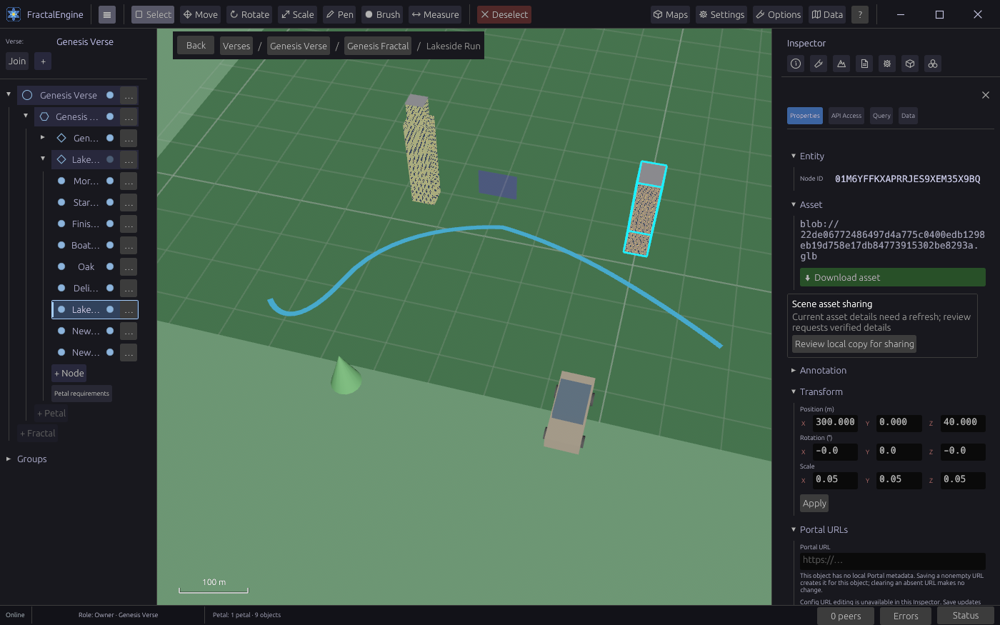
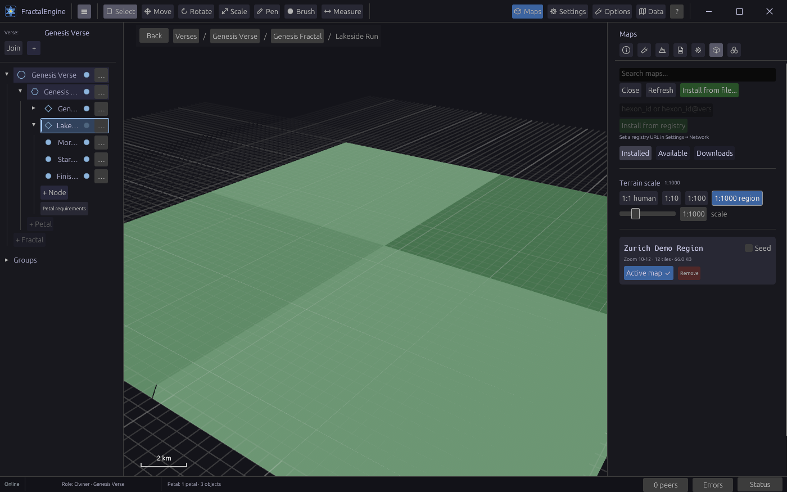
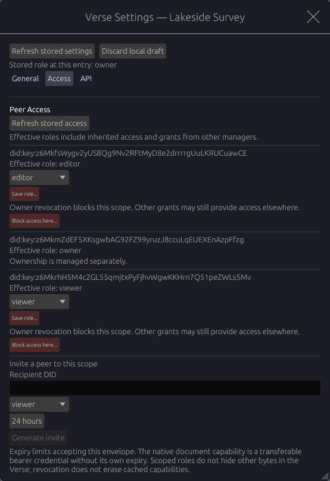
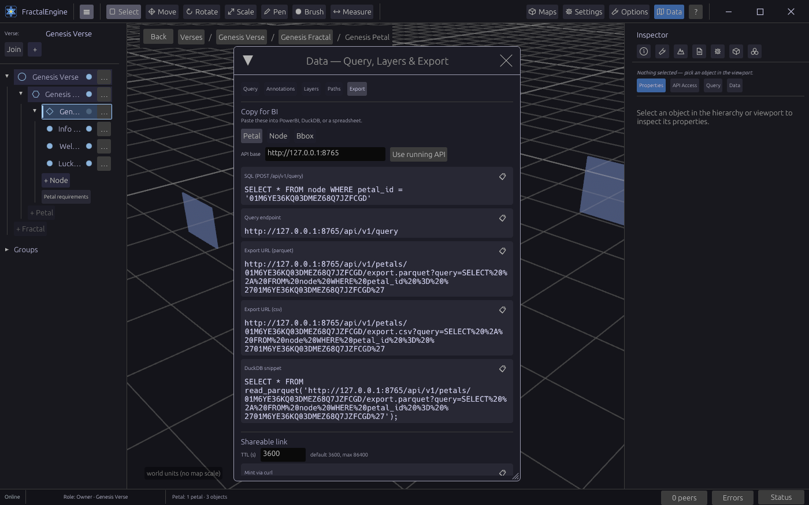

# FractalEngine

[](https://github.com/Escherbridge/fractalengine/actions/workflows/build-artifacts.yml)

A **spatial analytics engine**. FractalEngine ingests real-world geodata — maps,
terrain, GPX paths, IoT readings — into an embedded spatial database, and its
headline capability is **BI egress**: copy a SQL string or API URL out of the
app and paste it into PowerBI, a spreadsheet, or DuckDB. No connector SDK, no
export wizard — your reporting tool talks straight to your data.

Under the analytics layer sits a **peer-to-peer 3D digital-twin substrate** — the
project's key differentiator: a Bevy-based editor where you build 3D spaces, place
models, draw paths over real terrain, and share worlds with peers **without a
central server**. Where other spatial analytics tools assume a hosted backend,
FractalEngine's data layer replicates peer-to-peer.

**Single binary. Local-first. Your data stays in your database.**

> **Why this exists:** [PURPOSE.md](PURPOSE.md) — what FractalEngine is for,
> what it is and is not, and what it must never be used for.



---

## Status: alpha

Pre-1.0, under active development. What that means concretely:

**Works today**

- 3D viewer/editor — Bevy 0.18 scene editor with egui panels, orbit camera, gizmos, node inspector, and undo/redo (Ctrl/Cmd+Z, Ctrl/Cmd+Shift+Z) for transforms and single path-point moves
- Entity hierarchy (Verse > Fractal > Petal > Node) persisted in embedded SurrealDB (SurrealKV)
- GLTF/GLB asset import, content-addressed via BLAKE3
- Maps: per-petal terrain tiles with real-world scale metadata and a scale-bar HUD; maps package and install as `.hexon` files, stream between peers over iroh, and each petal can bind its own map and render distance
- GPX import and path editing — pen tool with curves, vertex/segment selection, repeated-model stamping along paths
- HTTP/WS API gateway on `127.0.0.1:8765` — REST, live scene subscriptions, MCP tools, and an agent screenshot/camera surface — plus a headless relay binary (Dockerfile included; the GHCR image publishes with tagged releases)
- JWT auth, hierarchical RBAC, deny-by-default policy engine
- Plugin system — Rhai and WASM sandboxes against the stable `fe-sdk` API, with UI slots. The desktop app starts the plugin host (T7) with a scoped, role-checked bridge to the database, but loads no plugin packages automatically (admission fails closed); `fe-relay` does not host it
- **Peer-to-peer sync** — a real iroh 1.3 / iroh-docs 0.101 stack replicates whole verses; roles replicate as per-grantor statements, and every inbound row is judged by deny-by-default RBAC at the DB thread (never trusted from a peer). A switchable mirror/sharded/balanced timeseries fabric carries IoT readings with honest per-query coverage reporting. See [Peer-to-Peer Sync & Distributed Data](#peer-to-peer-sync--distributed-data) below.
- **Generic device payloads** — a MIME-agnostic `asset` + `device_payload` + declared `device_format` model alongside IoT readings, for non-GLB device data (REST + MCP ingest, petal-scoped BI query, peer-to-peer replication)
- **Object history and property schemas** — each object keeps a committed version history that can be read page by page and replayed at an exact version, and property schemas are enforced and versioned (REST and MCP: `get_node_history`, `read_node_at_version`, `get_field_schema`, `set_field_schema`)
- **Access and invitations** — a per-entry Access tab (verse, fractal or petal) lists effective roles, assigns and revokes them, and issues addressed invitations; an API tab mints scoped tokens
- **BI egress** (the headline): GeoParquet/CSV export of nodes and IoT readings, signed share URLs, and an in-app "Copy for BI" card — verified end to end against DuckDB (see [docs/bi-egress.md](docs/bi-egress.md))



**In progress**

- Recent editor work (stamps as addressable nodes, earthwork sculpt regions, object-aware context menu, per-object REST/MCP endpoints, the Measure tool with its metric grid and saved callouts) is implemented but awaits in-app verification; the GPX path-length readout is done
- Release pipeline — Linux/Windows x64, Windows ARM64, musl relay and GHCR image jobs exist; the first tag-triggered release has not yet run

**Planned**

- Road/path builder input layer, map-authoritative scale everywhere, portable petal snapshots
- Extension platform: sealed `.hexon` packages carrying a Wasm component, and signed web bundles for the Petal Portal (tracks `extension_platform_20261107`, `portal_surface_20261107`)

Per-track doneness and the remaining work queue: [conductor/doneness-ledger.md](conductor/doneness-ledger.md).

**Known limitation:** op-log entries carry an ed25519 signature *field*, but
the legacy write paths store placeholder (all-zero) signatures; signed
operations belong to the canonical log. Do not rely on op-log integrity
guarantees yet (see [SECURITY.md](SECURITY.md)).

---

## Download

You can get prebuilt packages without building from source. The
[**rolling `latest` prerelease**](https://github.com/Escherbridge/fractalengine/releases/tag/latest)
is rebuilt from every `main` commit whose Linux and Windows build jobs pass.
Tagged `v*` releases are listed on the
[releases page](https://github.com/Escherbridge/fractalengine/releases).

| Download | Platform | What |
|---|---|---|
| [`fractalengine-windows-x86_64.zip`](https://github.com/Escherbridge/fractalengine/releases/download/latest/fractalengine-windows-x86_64.zip) | Windows 10/11 x64 | Desktop app |
| [`fractalengine-linux-x86_64.tar.gz`](https://github.com/Escherbridge/fractalengine/releases/download/latest/fractalengine-linux-x86_64.tar.gz) | Linux x64 (glibc 2.39+) | Desktop app |
| [`fe-relay-windows-x86_64.zip`](https://github.com/Escherbridge/fractalengine/releases/download/latest/fe-relay-windows-x86_64.zip) | Windows x64 | Headless relay |
| [`fe-relay-linux-x86_64.tar.gz`](https://github.com/Escherbridge/fractalengine/releases/download/latest/fe-relay-linux-x86_64.tar.gz) | Linux x64 (glibc 2.39+) | Headless relay |
| [`SHA256SUMS`](https://github.com/Escherbridge/fractalengine/releases/download/latest/SHA256SUMS) | — | Checksums (`sha256sum -c SHA256SUMS --ignore-missing`) |

Tagged releases also include `fractalengine-windows-aarch64.zip` and static musl
relays (`fe-relay-linux-musl-{x86_64,aarch64}.tar.gz`).

Each archive unpacks into a single folder. The desktop app's folder holds the
binary, an `assets/` folder of sample models, `QUICKSTART.txt`, and the licence
files. Extract the **whole** archive, read `QUICKSTART.txt`, and run
`fractalengine` (or `fractalengine.exe`) from that folder. While `assets/` sits
next to the binary, the app keeps its database in a `data/` folder beside it,
wherever you launch it from. To back up or move an install, copy the whole
folder; settings and installed map tilesets live in per-user folders (see
`QUICKSTART.txt`). The rolling packages are unsigned alpha builds (a tagged
release's notes say whether it is signed), and there is no macOS build.

---

## Quick Start

### Prerequisites

| Requirement | Version | Install |
|---|---|---|
| Rust | 1.96+ | `rustup toolchain install stable` (the repo pins 1.99.0 in `rust-toolchain.toml`, which rustup picks up automatically) |
| rustfmt | latest | `rustup component add rustfmt` |

Platform-specific system packages (WebKitGTK on Linux, VS Build Tools on
Windows, Xcode CLT on macOS) are covered in [BUILDING.md](BUILDING.md), along
with a known `RUST_MIN_STACK` workaround for compiling `surrealdb-core`.

### Build & Run

```bash
# Release build (GUI binary)
cargo build --release -p fractalengine

# Run
cargo run -p fractalengine

# Debug logging
RUST_LOG=debug cargo run -p fractalengine

# Headless relay (no GPU/windowing/keychain)
cargo build --release -p fractalengine-relay
```

### Test / Lint / Format

```bash
# Pre-commit gate: type-check the crates you touched
cargo check -p fe-ui -p fe-database      # example; name your own crates

# Format (CI's lint job runs this)
cargo fmt --check

# CI's lint job also runs these two (fuzzing needs nightly + Linux).
# CI lint is warn-only: failures become run-summary warnings, never a red run.
# The one exception is a crash found by the fuzzer, which holds back the
# rolling `latest` publish.
cargo deny --all-features check advisories bans sources licenses
cd fuzz && cargo +nightly fuzz run jwt_parse -- -max_total_time=60
```

CI's PR test sweep is intentionally scoped to three crates (`cargo test --release --no-fail-fast -p fe-ui -p fe-terrain -p fractalengine`), plus two named `fe-sync` acceptance tests on Linux (the iroh store migration and the relay-assisted connection); the full suite runs only through the batch runner described below.

Tests run in selectable batches, on purpose rather than by habit. Each batch in
[conductor/test-batches.md](conductor/test-batches.md) is a short list of plain
`cargo test -p <crate> ...` commands (a name filter or a `--test` file), which you can also run directly on
any OS. The PowerShell runner executes one command at a time and deletes that
command's test executables afterwards:

```powershell
tools\qa\test_batches.ps1                            # list the batches (R1..R11, Harness, Misc, Slow)
tools\qa\test_batches.ps1 -Batches R1,R8 -ListOnly   # preview the cargo commands for R1 and R8
tools\qa\test_batches.ps1 -Batches R1,R8             # run them, one at a time
```

`-Batches All` runs every batch the same way, once, at the end of a larger
change. `cargo test --workspace` is retired: it links every test binary at
once, and one full sweep left 258 GB of test executables and debug symbols on
disk, so the runner refuses it. The policy is in [AGENTS.md](AGENTS.md) ("Test
execution policy").

```bash
# P2P scenario harness (real loopback iroh, no Bevy/GPU) — 18 scenarios;
# FE_HARNESS_SCENARIO=<name substring> runs a subset
cargo run -p fractalengine-test-harness
```

---

## Environment Variables

| Variable | Required | Default | Description |
|---|---|---|---|
| `RUST_LOG` | No | unset (errors only) | Log filter: a level (`trace`, `debug`, `info`, `warn`, `error`) or per-crate directives such as `fe_sync=debug` |
| `SURREAL_DATASTORE_SYNC_DATA` | No | `every` | SurrealKV fsync cadence: `never`, `every`, or a duration above 100 ms. Both binaries set `every` when it is unset; `true` is not a valid value |
| `FE_API_UPLOAD_QUOTA_BYTES` | No | `2147483648` | Cap on registered API-uploaded asset bytes per owner (413 past it) |
| `FE_ASSET_GC_INTERVAL_SECS` | No | `3600` | Seconds between unreferenced-asset GC passes (`0` disables) |
| `FE_ASSET_GC_GRACE_SECS` | No | `86400` | Minimum age of an unreferenced asset before GC deletes it |
| `FE_API_SCREENSHOT_ALLOW` | No | on (unset) | `0` turns off the Owner-only agent screenshot and camera surface (`GET`/`POST /api/v1/debug/screenshot`, `GET /api/v1/debug/camera`, MCP `screenshot` and `get_camera`) on the desktop app; any value other than `0` or `1` also turns it off |
| `FE_API_INPUT_ALLOW` | No | off (unset) | `1` enables Owner-only synthetic pointer/keyboard/scroll input (`POST /api/v1/debug/input`, MCP `inject_input`) and the read-only UI inspection tools (`ui_tree`, `ui_state`, `ui_logs`) on the desktop app |
| `FE_API_ELEVATED_ALLOW` | No | off (unset) | `1` enables `POST /api/v1/query/elevated` (raw SurrealQL, Owner tokens). It is not scope-confined: an Owner of any verse reaches every verse on the node, so enable it only on a node whose verses all belong to one owner |
| `FE_API_DEV_TOKEN_OUT` | No | unset (off) | Path of a file the desktop app fills with loopback-only API tokens for every local verse (Owner where this node owns the verse, 8 h lifetime); it is how a local agent gets the token the capture endpoints need |
| `FE_SYNC_RELAY` | No | `default` | iroh relay mode: `default` (n0's public relays), `disabled` (LAN only), or comma-separated relay URLs. Overrides Settings > Network > Relay |
| `FE_SYNC_BOOTSTRAP` | No | unset | Semicolon-separated iroh `EndpointAddr` JSON entries to dial for every opened replica |
| `FE_P2P_DIR` | No | `data/p2p` | Persistent iroh replica store |
| `FE_BLOB_DIR` | No | `data/blobs` | Content-addressed blob store (the relay derives it from `FE_DB_PATH`'s folder when unset) |
| `FE_HEXON_DIR` | No | `<local data dir>/fractalengine/hexons/tilesets` | Installed map tilesets (local data dir: `%LOCALAPPDATA%` on Windows, `~/.local/share` on Linux) |

The headless relay reads the same variables, except the three desktop-only agent
rows (`FE_API_SCREENSHOT_ALLOW`, `FE_API_INPUT_ALLOW`, `FE_API_DEV_TOKEN_OUT`),
and adds `FE_BIND_ADDR`, `FE_DB_PATH`, `FE_CORS_ORIGINS`,
`FE_SHUTDOWN_AFTER_SECS` and its secret variables; see
[fractalengine-relay/README.md](fractalengine-relay/README.md).

Desktop settings (render distance, caps, offline tiles, camera, relay, scale
bar, metric grid) persist as RON at `<config dir>/fractalengine/settings.ron`
(`%APPDATA%\fractalengine\settings.ron` on Windows); a corrupt file is kept
as `settings.ron.corrupt-<ts>` and defaults load. Viewport keys added
2026-10-11: `M` Measure tool (tape / area), `H` hide selection, `Shift+H`
show all, `Alt+H` isolate (Esc clears it).

---

## Architecture Overview

FractalEngine runs as a single native desktop application with a
**seven-thread topology** (`fe-relay` runs T2 through T6 without a window and starts the plugin host, T7, only when built with the opt-in `plugin-host` feature):

```
┌─────────────────────────────────────────────────────┐
│  T1 — Main Thread (Bevy ECS + wry WebView)          │
│  Renders 3D world, processes input, drains events   │
└──────────────┬────────────────────┬─────────────────┘
               │  crossbeam (256)   │  crossbeam (256)
┌──────────────▼──────────┐  ┌─────▼──────────────────┐
│  T2 — Network Thread    │  │  T3 — Database Thread   │
│  libp2p (Kademlia/QUIC) │  │  SurrealDB (SurrealKV)  │
│  Dedicated Tokio runtime│  │  Dedicated Tokio runtime│
└─────────────────────────┘  └─────────────────────────┘
┌─────────────────────────┐  ┌─────────────────────────┐
│  T4 — Sync Thread       │  │  T5 — Replication Bridge│
│  iroh blobs/gossip/docs │  │  DB → Sync (row events) │
└─────────────────────────┘  └─────────────────────────┘
┌─────────────────────────┐  ┌─────────────────────────┐
│  T6 — API Gateway       │  │  T7 — Plugin Host       │
│  axum HTTP/WS on :8765, │  │  Rhai + WASM sandboxes  │
│  MCP tools (multi-thread│  │  Dedicated Tokio runtime│
│  Tokio)                 │  │                         │
└─────────────────────────┘  └─────────────────────────┘
```

All cross-thread communication uses **typed crossbeam channels** — never raw
bytes, never shared mutable state.

> See [docs/diagrams.md](docs/diagrams.md) for full architecture diagrams
> including data flow, auth sequences, and component interactions.

---

## Peer-to-Peer Sync & Distributed Data

The Sync Thread (T4) runs a real **iroh 1.3 / iroh-docs 0.101 / iroh-gossip 0.101 /
iroh-blobs 0.103** stack — `BlobsProtocol` + `Gossip` + `Docs` + a `Router`
accepting all three ALPNs — with persistent stores under `FE_P2P_DIR` (an
existing iroh 0.35 store is backed up and upgraded in place on first start). A verse's replica is a CRDT-backed
iroh-docs document: opening one subscribes the verse's gossip topic, dials
bootstrap peers, and replays the doc's current entries through the same
inbound path a live write takes, so a row denied before RBAC converged
locally gets a second chance on every open. (A separate, legacy petal-level
replicator remains mock-backed — it is not part of this path.)



- **Policy at the data layer, not the wire.** Inbound replicated rows are
  admitted by the DB thread's deny-by-default RBAC gate (Editor+; the role
  comes from the node's own materialized role view, never from the row).
  Roles replicate as per-grantor statements (`role/{scope}/{peer}/{grantor}`)
  that converge to the same view in any arrival order. A statement counts only
  while its grantor holds Manager+, so revoking a manager re-judges everything
  that depended on them. A scene row must also have been written while its
  author held Editor, so a later re-grant does not bring back rows written
  during a revocation. A row denied only because roles had not converged is
  deferred and retried; reopening the replica replays anything that was lost.
  Outbound writes from the local DB are never gated a second time on their way
  out.
- **Batching and fairness.** Node transform publications are deferred and
  batched (a burst of writes to one node publishes one row version), unchanged
  rows are not rewritten, and inbound rows queued behind one apply run in the
  same DB command (up to 64), each judged on its own. After a failed content download,
  re-fetches are armed only for authors the verse names (its owner or anyone
  its role view admits), each author gets its own share of the retry table, and
  attempts slow down but never stop.
- **Timeseries fabric.** IoT readings replicate append-only via union
  semantics, in one of three switchable per-verse modes — `mirror` (every
  peer holds everything), `sharded` (one host per shard), or `balanced`
  (replication factor R) — tracked in a per-verse shard ledger that rides the
  verse's own doc. Distributed window/aggregate queries fan out over the
  verse's gossip topic and merge per-host partials, reporting which shards
  were actually covered vs. missing rather than guessing.
- **Simulation lab.** `fe-sim` runs deterministic, scripted multi-peer
  scenarios — virtual doc + gossip planes, an accelerable clock, scripted
  faults — against the SAME replicator trait production code uses, so sim and
  prod cannot drift by construction. It runs from the `fe-sim` CLI or against a
  `sim-control` build of `fe-relay` started with `FE_SIM_ALLOW=1`; the desktop
  app never exposes it. See [docs/simulation-lab.md](docs/simulation-lab.md).
- **Maps over iroh.** A `.hexon` tileset moves between peers as one iroh
  HashSeq of size-tuned bundles, resumable and verified by hash per bundle.
  Each petal binds its own map and an optional `render_distance`, both stored
  as replicated petal columns. See [AGENTS.md](AGENTS.md) §petal-map and
  §tileset-p2p.
- **BI egress.** Export nodes and IoT readings as Parquet/CSV over signed,
  time-limited share URLs for DuckDB, PowerBI, or a spreadsheet — no database
  credentials required. See [docs/bi-egress.md](docs/bi-egress.md).
- **MCP surface.** 55 machine-callable tools in total (no shipped binary
  advertises all of them) behind one table-driven authorization path: a role
  floor plus a scope rule resolved from the DB, never from caller-supplied
  ancestry ids. 36 are advertised on every host.
  The desktop app adds `screenshot`, `get_camera`, `inject_input` and five UI
  inspection and window-control tools (`ui_tree`, `ui_state`, `ui_logs`,
  `dialog_answers`, `window`) and, on GUI hosts, five extension and binding tools
  (`list_extensions`, `extension_command`, `list_bindings`, `set_binding`,
  `clear_binding`). `screenshot` and `get_camera` are on unless
  `FE_API_SCREENSHOT_ALLOW=0`; the rest need `FE_API_INPUT_ALLOW=1` (see
  [Environment Variables](#environment-variables)); the five `sim_*` tools
  appear only on a simulation-lab relay, and `get_network_diagnostics` appears only
  on hosts that wire the sync diagnostics bridge (the desktop app does).
- **Relays and the iroh 1.x flag day.** iroh 0.35 and 1.x peers cannot
  interoperate, so every peer of a swarm upgrades together (any iroh v1 minor
  talks to any other). The default relays are n0's public iroh v1 fleet —
  supported for the life of v1, but shared and rate-limited. For production,
  point `FE_SYNC_RELAY` (or the desktop's Settings > Network relay field,
  persisted in `settings.ron`; the env var wins) at your own `iroh-relay` 1.x
  server, or set it to `disabled` for LAN-only — see
  [fractalengine-relay/README.md](fractalengine-relay/README.md).

---

## Entity Hierarchy

FractalEngine uses a botanical/fractal naming convention:

```
Verse                the top-level P2P namespace
  ├── VerseMember    peer membership records (invite-based)
  └── Fractal        groups Petals under a Verse
        └── Petal    a 3D world/space
              ├── Node     an interactive object (placed via right-click)
              │     └── Asset   GLTF/GLB model (content-addressed via BLAKE3)
              ├── Room     a zone within a Petal
              │     └── Model    a placed 3D object (legacy)
              └── Role     RBAC assignment (peer ↔ verse, fractal or petal scope)
```

---

## Workspace Crates

26 workspace members; the load-bearing ones:

| Crate | Purpose | Thread |
|---|---|---|
| `fractalengine` | GUI binary — wires threads together | T1 |
| `fractalengine-relay` | Headless relay binary (`fe-relay`) | — |
| `fe-runtime` | Bevy ECS app, channel management, message types | T1 |
| `fe-network` | libp2p swarm (Kademlia over QUIC); the iroh data transport lives in `fe-sync` | T2 |
| `fe-database` | SurrealDB persistence, RBAC, op-log | T3 |
| `fe-identity` | Ed25519 keypair, JWT, DID:key, OS keychain | Shared |
| `fe-policy` | Deny-by-default policy engine (RBAC decisions) | Shared |
| `fe-renderer` | GLTF pipeline, content addressing, camera | T1 |
| `fe-webview` | wry browser overlay, typed IPC, URL security | T1 |
| `fe-sync` | iroh blobs/gossip/docs stack, verse replication, tileset transfer, relay config | T4 |
| `fe-ui` | egui panels, inspectors, managers | T1 |
| `fe-api` | axum HTTP/WS gateway, MCP tools, ApiClaims auth | T6 |
| `fe-query` | Query builder, GIS queries, GeoParquet export | T3/T6 |
| `fe-terrain` | Terrain tiles, GPX, mesh generation, IoT layers | T1 |
| `fe-format` / `fe-entity-store` | Canonical data formats + entity storage | Shared |
| `fe-hexon` / `fe-hexon-registry` | `.hexon` packaging and publishing, plus a registry HTTP service | Shared |
| `fe-plugin` / `fe-sdk` / `fe-plugin-test` | Plugin engines, stable SDK, test kit | T7 |
| `fe-canonical-log` | Signed canonical operation log | Shared |
| `fe-sim` | Deterministic multi-peer simulation lab (sim-only) | Test |
| `fe-test-harness` | Multi-peer integration scenarios | Test |
| `extensions/iot-bridge` | Reference extension | T7 |
| `tools/fe-ext` | Extension authoring CLI | Tooling |

---

## Key Dependencies

| Crate | Version | Role |
|---|---|---|
| `bevy` | 0.18 | ECS 3D engine |
| `surrealdb` | 3.0 | Embedded database (SurrealKV backend) |
| `libp2p` | 0.56 | Peer discovery (Kademlia DHT over QUIC) |
| `iroh` | 1.3 | QUIC endpoint, relays, NAT traversal |
| `iroh-blobs` | 0.103 | BLAKE3 content-addressed asset distribution |
| `iroh-gossip` | 0.101 | Epidemic broadcast for zone events |
| `iroh-docs` | 0.101 | CRDT key-value sync |
| `ed25519-dalek` | 2.2 | Ed25519 signatures |
| `jsonwebtoken` | 10.3 | JWT minting/verification |
| `wry` | 0.54 | Embedded WebView (Tauri org) |
| `bevy_egui` | 0.39 | In-game UI |
| `axum` | 0.8 | HTTP/WebSocket API gateway |

---

## Key Design Invariants

- **No Tokio on T1** — Bevy uses smol; use `AsyncComputeTaskPool` for async work
- **No `block_on()` in Bevy systems** — send commands via channels instead
- **RBAC enforced at the data layer** — the fe-policy engine on the DB thread, deny-by-default, never in Bevy systems
- **All assets content-addressed** — BLAKE3 hash is the canonical ID
- **All mutations logged** — append-only op-log with hybrid logical clock; per-op ed25519 signing is designed but **not yet implemented** (see Status)
- **WebView URL denylist** — blocks localhost, 127.0.0.1, RFC 1918 unconditionally
- **GLTF/GLB only** — no FBX/OBJ; operators convert via Blender

---

## API Gateway

The `fe-api` crate provides an axum-based HTTP/WebSocket API on port 8765.



### REST Endpoints

| Method | Path | Auth | Description |
|--------|------|------|-------------|
| GET | `/api/v1/health` | No | Liveness probe |
| GET | `/ready` | No | Readiness probe (DB ping) |
| GET | `/api/v1/hierarchy` | Bearer JWT | Full scene hierarchy snapshot |
| POST | `/api/v1/verses` | Bearer JWT | Create a verse |
| POST | `/api/v1/verses/:vid/fractals` | Bearer JWT | Create a fractal |
| POST | `/api/v1/verses/:vid/fractals/:fid/petals` | Bearer JWT | Create a petal |
| POST | `/api/v1/verses/:vid/fractals/:fid/petals/:pid/nodes` | Bearer JWT | Create a node (optional `asset_id` places an asset the petal owns) |
| PATCH | `/api/v1/nodes/:id/transform` | Bearer JWT | Update node transform |
| GET | `/api/v1/nodes/:id/transform` | Bearer JWT | Read node transform |
| GET | `/api/v1/assets/:content_hash` | Bearer JWT | Content-addressed asset delivery (immutable caching) |
| GET / PUT | `/api/v1/petals/:pid/visibility-groups` | Bearer JWT | Read (Viewer+) / replace (Editor+) a petal's visibility Group registry |
| PATCH / DELETE | `/api/v1/petals/:pid/visibility-groups/:gid` | Bearer JWT | Upsert / remove one Group (Editor+) |

The table lists the core routes; `fe-api/AGENTS.md` §routes has the full inventory (`server.rs::build_router` is the source of truth), including the MCP endpoint `POST /mcp`.

**Agent visual verification.** On the desktop app, an Owner token whose scope covers the open verse can fetch a PNG of the live window (viewport + all UI) with `GET /api/v1/debug/screenshot`, run a posed capture with `POST` to the same path (`window` or `scene` mode; pose kinds `camera`, `orbit`, `geo`, `tile` or `focus`; the resolved pose comes back in the `X-FE-Capture-Pose` header), and read the live camera with `GET /api/v1/debug/camera`. MCP offers the same as `screenshot` and `get_camera`. This surface is **on by default**; set `FE_API_SCREENSHOT_ALLOW=0` to turn it off. Limits are 1 capture per second and 10 camera reads per second per caller, and a window capture shows the whole UI, including the verse list. Synthetic input (`POST /api/v1/debug/input`, MCP `inject_input`) is separate and **off** unless `FE_API_INPUT_ALLOW=1`; it is refused with 409 while a posed capture holds the camera. `FE_API_DEV_TOKEN_OUT` makes the app write a local token file for agents. `F12` saves a capture locally to `data/screenshots/`. See `fe-api/AGENTS.md` §screenshot, §camera-state and §agent-input-surface.

### WebSocket Protocol (`/ws`)

After connecting, the server sends `auth_required`. The client must respond with
an `auth` message containing a valid API token within 5 seconds.

**Thin client connection flow**:
1. Connect to `/ws`; server sends `auth_required`.
2. Client sends `auth { access_token }` (Bearer API token) → `auth_ok`.
3. Client sends `scene_subscribe { petal_id }` (scope-checked against the token).
4. Server responds with `scene_snapshot { petal_id, version, nodes }`.
5. On CUD mutations, server pushes `scene_delta { petal_id, version, changes }`
   where each change is a `SceneChange` (`node_added` / `node_removed` /
   `node_renamed` / `node_transform` / `property_changed`).

**Entity commands** (CUD over WS, editor role required):
Client sends `entity_command { request_id, command }` where `command` is one of
`create_node`, `delete_node`, `set_node_property`, `delete_node_property`
(tagged by `op`). Server replies with
`entity_command_result { request_id, ok, data?, error? }` echoing the request id;
the resulting `scene_delta` is broadcast to all scene subscribers.

**Transform streaming**: Subscribe to a petal channel, then receive real-time
`transform_update` messages as other clients modify node positions. Failed
persists are rolled back via `transform_rollback`.

---

## Documentation

| Document | Description |
|---|---|
| [PURPOSE.md](PURPOSE.md) | Why this exists, what it is for, and what it must never be used for |
| [BUILDING.md](BUILDING.md) | Per-platform build instructions and known issues |
| [docs/guide.md](docs/guide.md) | Comprehensive developer guide |
| [docs/editor-guide.md](docs/editor-guide.md) | Editor usage guide (Pen tool, paths, curves) |
| [docs/diagrams.md](docs/diagrams.md) | Architecture diagrams index (Mermaid) |
| [docs/bi-egress.md](docs/bi-egress.md) | BI egress: connecting DuckDB/PowerBI/spreadsheets |
| [docs/simulation-lab.md](docs/simulation-lab.md) | Simulation lab: scripted multi-peer P2P scenarios (fe-sim) |
| [docs/images/MANIFEST.md](docs/images/MANIFEST.md) | Screenshot manifest: what each documentation image shows and how to capture it |
| [docs/security-checklist.md](docs/security-checklist.md) | Security audit checklist |
| [docs/webview-threat-model.md](docs/webview-threat-model.md) | WebView threat model |
| [conductor/product.md](conductor/product.md) | Product vision and entity hierarchy |
| [conductor/tech-stack.md](conductor/tech-stack.md) | Technology decisions and constraints |
| [conductor/roadmap.md](conductor/roadmap.md) | Strategic roadmap + go-forward slate |
| [conductor/tracks.md](conductor/tracks.md) | Live implementation-track board |
| [conductor/doneness-ledger.md](conductor/doneness-ledger.md) | Per-track doneness + classified remaining-work queue |

---

## License

Licensed under the Apache License, Version 2.0 ([LICENSE-APACHE](LICENSE-APACHE)).

The license governs your legal rights. [PURPOSE.md](PURPOSE.md) states the
intent and the conditions under which this work is offered; contributions,
registry listings, and official support are held to it.

Unless you explicitly state otherwise, any contribution intentionally submitted
for inclusion in the work by you, as defined in the Apache-2.0 license, shall be
licensed as above, without any additional terms or conditions.

Note: the embedded SurrealDB engine is a dependency licensed separately under
the Business Source License 1.1.
