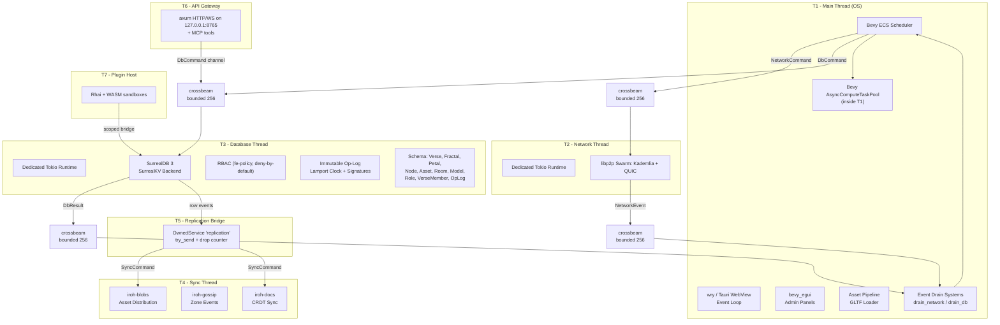

# System Overview

High-level view of FractalEngine's runtime architecture: the seven-thread topology with all major subsystems. The headless `fe-relay` runs T2 through T6 and starts the plugin host (T7) only when built with the opt-in `plugin-host` feature (`fractalengine-relay/src/main.rs:355-359`).

Sources: see `docs/diagrams.md` section "diagram-truth".
