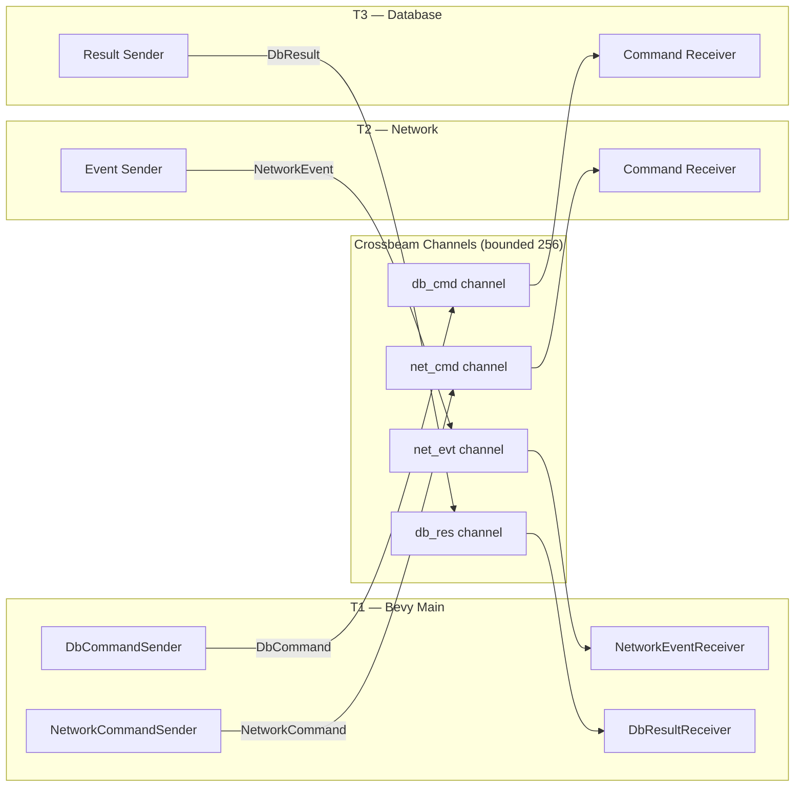
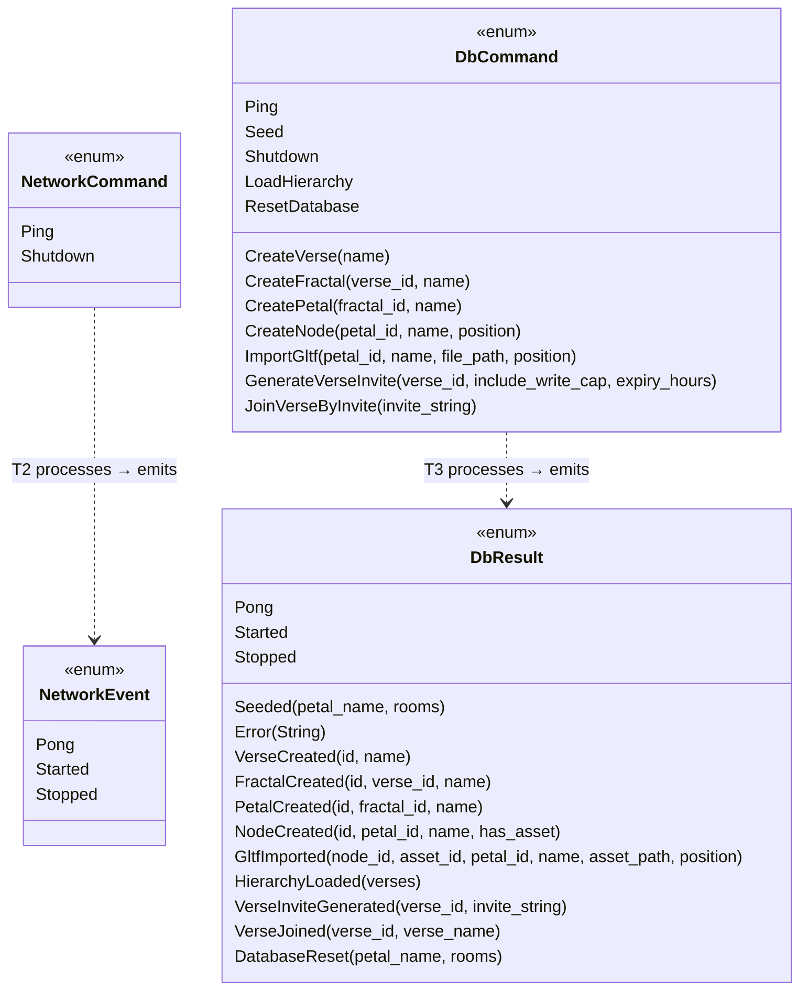

# Channel Bridge

The net and db channels connect T1 to T2 and T3; the other seven-thread relays (T3 to T5 to T4 replication, the T6 API command channel, the T7 plugin bridge) are not drawn here. The net and db channels are bounded at 256 to provide backpressure.



## Message Types



## Hierarchy Data Flow

The `LoadHierarchy` command returns the full tree as nested structs:

```
DbResult::HierarchyLoaded
  └── Vec<VerseHierarchyData>
        ├── id, name, namespace_id
        └── Vec<FractalHierarchyData>
              ├── id, name
              └── Vec<PetalHierarchyData>
                    ├── id, name
                    └── Vec<NodeHierarchyData>
                          ├── id, name, has_asset, position
                          ├── asset_path (optional)
                          └── petal_id
```
