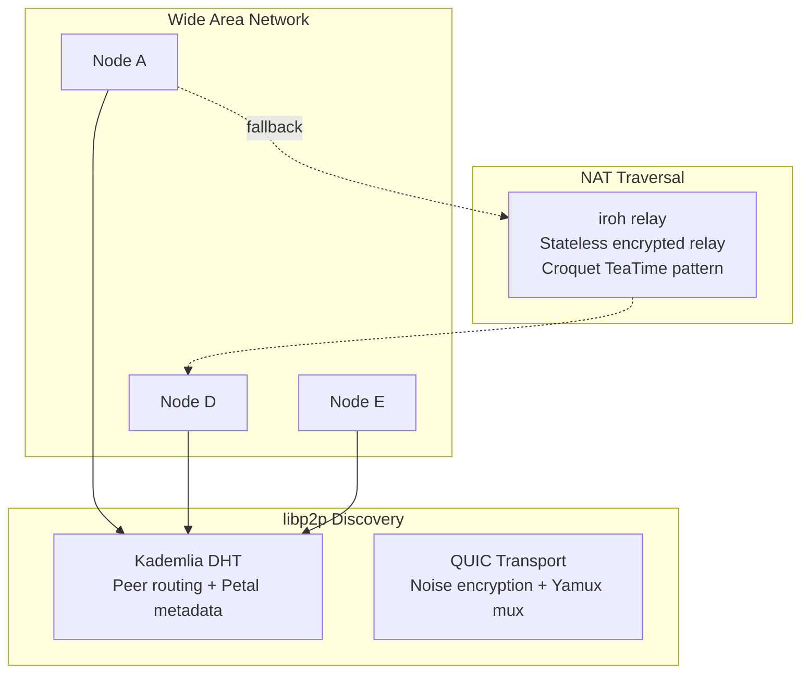
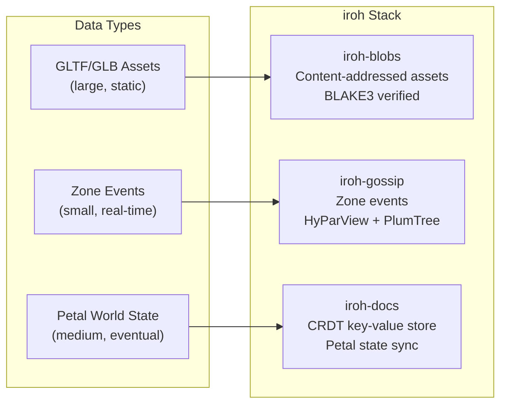
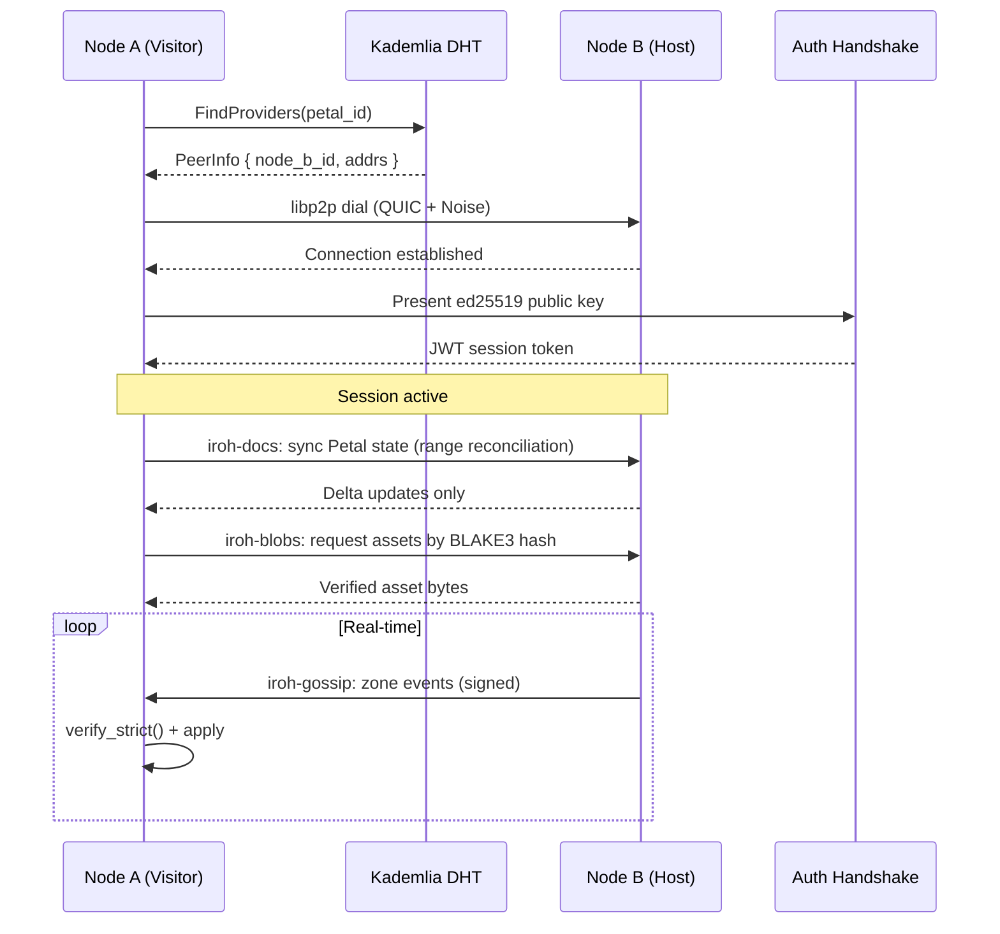

# Network Topology

## Peer Discovery

WAN peers are found through the Kademlia DHT, with the iroh relay as fallback. LAN auto-discovery is not implemented.

## Data Distribution Layers

## Peer Connection Lifecycle

